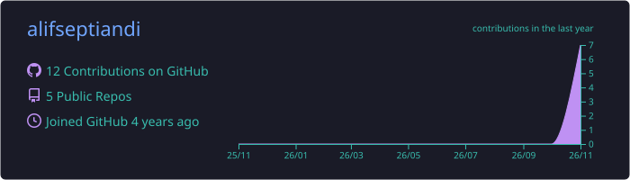
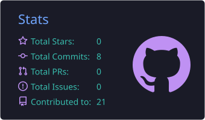

<!-- ===== HEADER ===== -->
<p align="center">
  
</p>

<p align="center">
  <a href="https://git.io/typing-svg">
    
  </a>
</p>

<p align="center">
  
  
  
</p>

---

### 🧑‍💻 About Me

```js
const septiandy = {
  role:        "Junior Frontend Developer",
  location:    "Bekasi, West Java, ID 🇮🇩",
  currently:   ["Hotel system integrations (VHP)", "Building my own web apps"],
  learning:    ["React", "Svelte", "Tailwind CSS", "Python"],
  funFact:     "I build Excel macros and web apps with the same energy ☕",
  motto:       "There's a time for daring and there's a time for caution.",
};
```

- 🚀 I thrive on turning creative concepts into **clean, usable interfaces**
- 🧠 I enjoy tackling **complex problems** — from UI bugs to accounting reports
- 💡 Driven to build apps that are **intuitive, accessible, and good-looking**

---

### 🛠️ Tech Stack

<p align="center">
  <br/><br/>
  
</p>

<p align="center"><sub>Top row: daily tools · Bottom row: currently exploring</sub></p>

---

### 🌟 Featured Projects

| Project | Description | Stack |
|---|---|---|
| 🌐 [**Portfolio**](https://septiandy-portfolio.vercel.app/) | My personal portfolio site | React · Vercel |
| 📒 **Septiandy Ledger** | Personal ledger web app with login & reports | JS · Supabase · Vercel |
| 🏨 **VHP Import Tools** | Excel → VHP import programs for hotel operations | Progress 4GL |

---

### 📊 GitHub Stats

<p align="center">
  
</p>

<p align="center">
  
  
</p>

<p align="center">
  
</p>

---

### 🐍 Contribution Snake

<p align="center">
  <picture>
    <source media="(prefers-color-scheme: dark)" srcset="https://raw.githubusercontent.com/alifseptiandi/alifseptiandi/output/github-snake-dark.svg" />
    
  </picture>
</p>

---

### 🤝 Connect With Me

<p align="center">
  <a href="https://septiandy-portfolio.vercel.app/"></a>
  <a href="https://linkedin.com/in/YOUR_LINKEDIN"></a>
  <a href="https://instagram.com/alifseptiandii"></a>
  <a href="https://x.com/unorthodoxnun"></a>
  <a href="mailto:YOUR_EMAIL"></a>
</p>

<!-- ===== FOOTER ===== -->
<p align="center">
  
</p>
